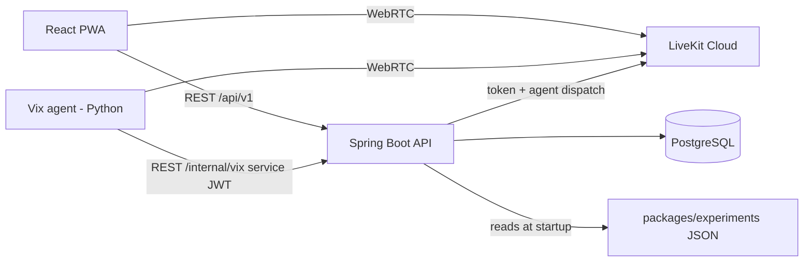
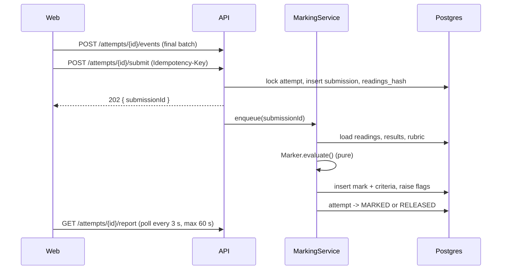

# Design Document

**Feature:** Backend API (starting design; Kiro may refine)

## Overview
Spring Boot modular monolith, packaged by feature under `org.vixir`. Stateless REST + JWT. PostgreSQL via JPA with Flyway. Marking runs in-process on a bounded executor, recovered on restart. The Vix agent talks to the API only through `/internal/vix/**` with a service token.

## Architecture

## Modules (packages)
| Package | Responsibility | Key classes |
|---|---|---|
| `auth` | register, login, Google, refresh rotation, JWT issue/verify, security config | `AuthController`, `TokenService`, `RefreshTokenRepository`, `SecurityConfig` |
| `school` | institutions, settings, users, classes, enrolments, CSV import | `ClassController`, `ClassService`, `JoinCodeGenerator`, `UserImportService` |
| `experiment` | load/validate configs, catalogue queries, tours | `ExperimentLoader`, `ExperimentController`, `SchemaValidator` (networknt json-schema-validator) |
| `assignment` | assignments, attempts, event ingest, readings, submissions | `AssignmentService`, `AttemptService`, `EventIngestService`, `SubmissionService` |
| `marking` | pure evaluator + orchestration | `Marker` (pure), `Regression`, `SigFigRules`, `PrecautionMatcher`, `MarkingService` (Spring) |
| `review` | flags, analytics, overrides, release | `FlagService`, `AnalyticsService`, `ReleaseService` |
| `vix` | session bootstrap, LiveKit tokens, dispatch, internal agent endpoints | `VixSessionService`, `LiveKitTokenFactory`, `AgentDispatchClient` |
| `admin` | overview, audit log | `AdminController`, `AuditService` |
| `common` | problem details, request id, pagination, clock | `ApiExceptionHandler`, `RequestIdFilter` |

## Endpoints
| Method | Path | Role | Notes |
|---|---|---|---|
| POST | /auth/register | public | optional `classCode` |
| POST | /auth/login | public | sets `vx_refresh` cookie |
| POST | /auth/google | public | Google ID token |
| POST | /auth/refresh | cookie | rotation |
| POST | /auth/logout | any | revokes family |
| GET / PATCH | /me | any | profile, locale |
| GET | /institutions/{id} · PATCH /institutions/{id}/settings | ADMIN | |
| POST | /institutions/{id}/users/import | ADMIN | CSV, P1 |
| PATCH | /users/{id} | ADMIN | disable, role |
| POST / GET | /classes | TEACHER / any | create · list mine |
| GET / PATCH | /classes/{id} | owner | |
| POST | /classes/{id}/join-code/rotate | owner | |
| POST | /classes/join | STUDENT | `{ code }` |
| GET / DELETE | /classes/{id}/students[/{userId}] | owner | |
| GET | /experiments | public | `subject, level, curriculum` |
| GET | /experiments/{id}[/versions/{v}] | public | config + rubric summary |
| POST / GET | /assignments | TEACHER | create · list by class |
| GET / PATCH | /assignments/{id} | owner | |
| POST | /assignments/{id}/publish · /close · /release | owner | |
| GET | /me/assignments | STUDENT | dashboard |
| POST | /attempts | STUDENT / public | `{ assignmentId }` or `{ experimentId }`; anon allowed for practice |
| GET | /attempts/{id} | owner/teacher | |
| POST | /attempts/{id}/events | owner | batch ingest |
| GET | /attempts/{id}/events?afterSeq= | owner/teacher | resume, replay |
| POST | /attempts/{id}/submit | owner | Idempotency-Key |
| GET | /attempts/{id}/report | owner (RELEASED) / teacher | marks + reasons + comment |
| GET | /assignments/{id}/results | owner | per-student table |
| GET | /assignments/{id}/analytics | owner | histogram, criterion averages, common mistakes |
| PATCH | /submissions/{id}/mark | owner | override criterion, comment |
| GET / PATCH | /assignments/{id}/flags · /flags/{id} | owner | |
| POST | /vix/sessions | STUDENT | bootstrap |
| POST | /vix/sessions/{id}/end | owner | |
| GET | /vix/tours/{screenCode} | public | scripted tour JSON |
| GET | /internal/vix/sessions/{id}/context | service | |
| POST | /internal/vix/sessions/{id}/messages · /end | service | |
| GET | /admin/overview · /admin/audit | ADMIN | P1 |

## Submission and marking flow

Recovery: on startup, re-enqueue every SUBMITTED attempt with no MARK.

## Marker algorithm (per criterion type)
- `readings`: count distinct independent-variable values ≥ required; repeats agree within the instrument tolerance; no flagged rows unexplained.
- `table`: each derived cell recomputed from the row's measured cells; |stated − recomputed| / recomputed ≤ 0.005 after rounding to the stated precision; consistent decimal places down each column.
- `graph`: axes match `analysis.plot`; points within half a minor division of the true positions; best-fit line passes within tolerance of the least-squares line.
- `slope`: two chosen points on the student's line; Δx ≥ 0.5 × plotted x range; slope within 3% of least-squares slope.
- `derived`: implied = f(least-squares slope) per `analysis.derive`; award if |stated − implied| / implied ≤ `analysis.tolerance`.
- `precautions`: each experiment precaution has a keyword set; award one mark per matched precaution up to the criterion max.

## Security notes
- Access JWT: HS256 with `VIXIR_JWT_SECRET` (rotate via kid), claims `sub, role, inst, exp`. Service JWT: separate secret, claim `scope=vix-agent`.
- Ownership enforced in services with `@PreAuthorize("@access.canReadAttempt(#id)")`-style beans; 404 on denial.
- Anonymous practice attempts: random `anonToken` cookie binds them; purged nightly.

## Testing
- Unit: Marker with jqwik properties + fixture vectors.
- Integration: Testcontainers Postgres; one test per authorization rule; ingest idempotency; offline-late acceptance.
- Contract: OpenAPI snapshot test so web client changes are explicit.
