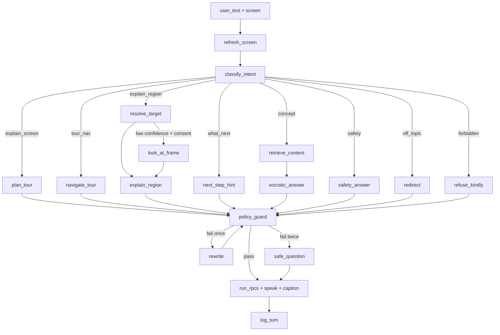

# Design Document

**Feature:** Vix agent (starting design; Kiro may refine)

## Stack
- Python 3.12, `uv` for deps. `livekit-agents` (with silero VAD, turn detector plugins), STT + TTS provider plugins chosen by latency test with Nigerian-English speakers (shortlist: Deepgram, AssemblyAI, Cartesia, ElevenLabs), `langgraph`, Anthropic SDK (Claude, vision-capable model), `httpx` for API calls, `pydantic` for contracts, `structlog`.
- Deployed as a LiveKit Cloud agent (or a container running `python -m vix_agent start`). Explicit dispatch by agent name `vix`.

## Package layout
```text
apps/vix-agent/
├── pyproject.toml
├── vix_agent/
│   ├── main.py            # AgentServer entrypoint, dispatch, session wiring
│   ├── session.py         # AgentSession setup: VAD, STT, TTS, turn detection, barge-in
│   ├── contracts.py       # pydantic models: ScreenMap, RPC payloads, Context (mirror contracts.md)
│   ├── api_client.py      # service-JWT calls to /internal/vix/**
│   ├── screen.py          # ScreenMap cache, request/refresh, reference resolver, frame sampler
│   ├── rpc.py             # typed wrappers: spotlight, point_at, start_tour, tour_step, end_tour, open_panel, show_caption
│   ├── graph/
│   │   ├── state.py       # VixState
│   │   ├── nodes.py       # nodes below
│   │   ├── policy.py      # rule checks + classifier prompt
│   │   ├── prompts/       # system + per-intent prompts (versioned)
│   │   └── build.py       # StateGraph wiring
│   └── tours.py           # scripted tour loading + filtering
├── evals/                 # scripted turns per lab, expected intent + policy outcome
└── tests/
```

## State
```python
class VixState(TypedDict):
    session_id: str
    mode: Literal["PRACTICE", "GRADED"]
    locale: str
    first_name: str
    experiment: ExperimentContext   # procedure, precautions, glossary, tours
    screen: ScreenMap | None
    frame_b64: str | None
    user_text: str
    intent: Literal["explain_screen", "explain_region", "what_next", "concept", "safety", "tour_nav", "off_topic", "forbidden"]
    target_ids: list[str]
    tour: TourState | None
    draft: str
    rpc_plan: list[RpcCall]
    reply: str
    blocked: bool
```

## Graph

- `classify_intent`: small fast model call with the ScreenMap labels; also detects "forbidden" (give me the answer, change my reading, submit for me).
- `plan_tour`: scripted steps for the screen code ∩ visible regions; LLM only adapts wording to locale and age.
- `retrieve_content`: in-memory BM25 over the experiment's briefing, theory, procedure, glossary (small corpus; no vector DB needed for P0).
- `policy_guard`: regex rules (number + unit for the experiment's quantities; "answer is"; "your value"), plus a classifier call returning `{leak: bool, reason}`. GRADED only for numbers; all modes for forbidden actions.

## Latency plan
- Stream LLM tokens straight to TTS; run `policy_guard` on sentence boundaries (sentence-level gating) so first audio isn't delayed by the whole reply.
- Prefetch context at join; cache tours; keep ScreenMap fresh via push (no polling).
- Target budget: STT final 250 ms · intent 250 ms · first sentence 400 ms · TTS first audio 250 ms.

## Prompts (essentials)
- System: role (lab guide for secondary/university students in Nigeria), mode rules, tone (warm, brief, ≤ 3 sentences per turn), never reveal hidden values, only refer to ids from the ScreenMap, prefer questions over statements in GRADED mode, use the student's first name sparingly.
- Every prompt version is stored under `prompts/` with an id logged per turn.

## Testing
- Unit: resolver (labels/positions → ids), tour navigation property tests (hypothesis), policy rules property tests.
- Graph tests with a stubbed LLM; evals in `evals/` run in CI; leaks fail the build.
- Manual: latency test script using `lk` CLI against LiveKit Cloud.
