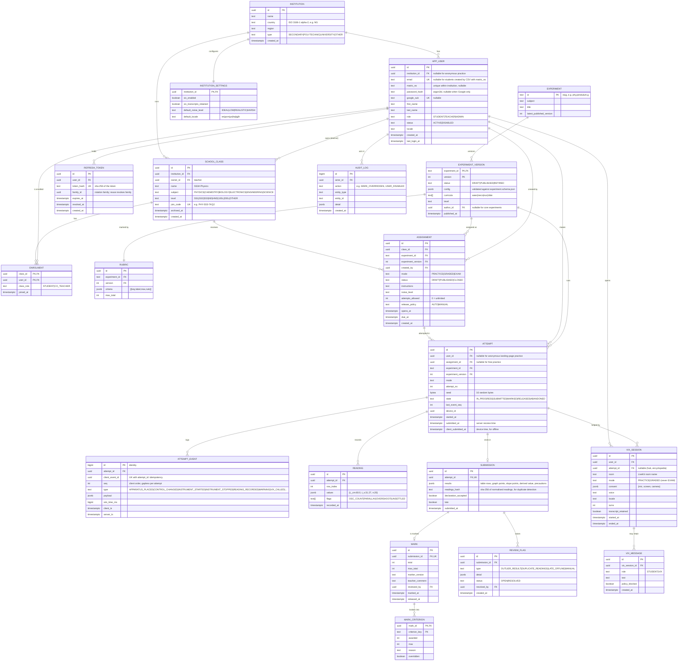

# Vixir data model (source of truth for the database)

Postgres. All ids are UUID v7 unless noted. All timestamps are `timestamptz` in UTC. Enums are Postgres `text` with CHECK constraints (easier Flyway changes). Soft delete only where stated.

## Key constraints and indexes
- `enrolment` PK (class_id, user_id); index (user_id).
- `attempt_event` UNIQUE (attempt_id, client_event_id); UNIQUE (attempt_id, seq); index (attempt_id, seq).
- `attempt` index (assignment_id, user_id); partial UNIQUE (assignment_id, user_id, attempt_no).
- `submission.readings_hash` index, used to find identical readings within one assignment.
- `school_class.join_code` UNIQUE, case-insensitive (citext or upper()).
- `app_user` UNIQUE (institution_id, matric_no) where matric_no is not null.
- Students are never deleted while they have submissions; admins disable them (status DISABLED). Data export and hard delete are admin actions recorded in audit_log.
